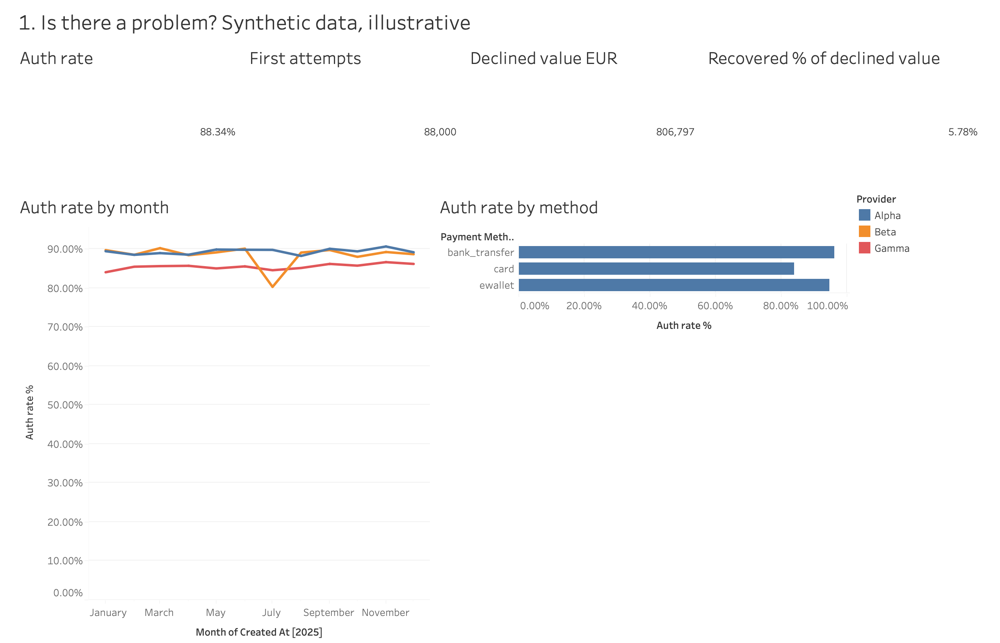
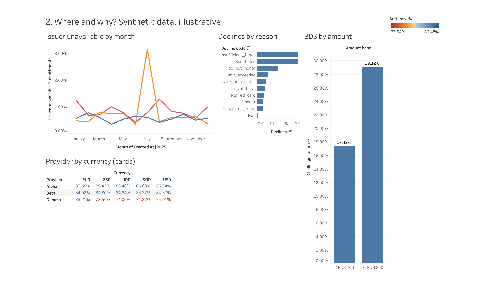
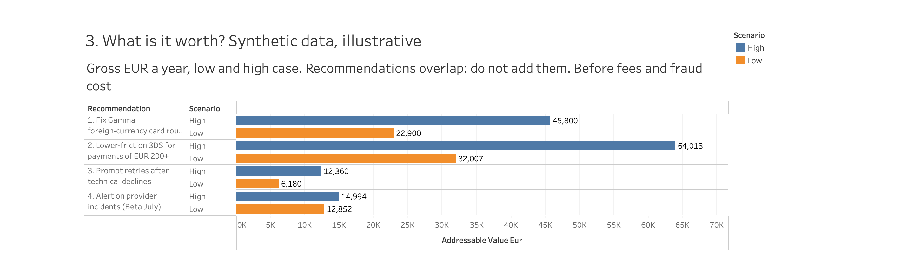

# Where do card payments fail, and what is it worth fixing?

A SQL and Python analysis of payment declines on a **synthetic** dataset of 90,319 payment attempts across 2025: data quality first, then findings, then whether each gap is statistically real, then what fixing it is worth in euros.

> **Read this first.** The data is generated by `generate_data.py`. No real company, customer or transaction is involved. Several patterns were built into the data on purpose, so the analysis has something to find. The figures below show the *method*, not facts about any real payments business. A second analysis on real public data, where nothing is planted, is in [`olist/`](olist/): it tests whether payment method predicts cancelled orders, and the answer is mostly no.

## Why this project

In payments QA, a failed payment starts with one question: why did this one fail? At scale the question becomes where the failures concentrate, whether a fix is worth the effort, and whether retries recover anything. This project works through that second set of questions, from raw attempts to a sized recommendation.

## The data

One row per payment attempt (`data/transactions.csv`):

| Column | Meaning |
|---|---|
| `transaction_id`, `created_at`, `user_id` | Attempt identifier, timestamp, customer |
| `payment_method` | card, ewallet, bank_transfer |
| `currency`, `provider`, `amount_eur` | Currency, one of three providers (Alpha, Beta, Gamma), amount in EUR |
| `three_ds_required`, `three_ds_outcome` | 3-D Secure requirement and result (frictionless, challenge_passed, challenge_failed, not_required) |
| `status`, `decline_code` | approved or declined, and the reason |
| `retry_of`, `is_retry` | Links a retry to the attempt it follows |

88,000 first attempts plus 2,319 customer retries, EUR 5.89 million requested on first attempts, of which EUR 0.81 million (13.7%) was declined. Seeded (`SEED = 42`), so the data and every result reproduce exactly.

## 1. Data quality first (`sql/quality_checks.sql`)

Seventeen rules, one row each: duplicate IDs, nulls, value ranges, status and decline-code consistency, retry links that point nowhere or backwards in time, 3-D Secure fields that contradict each other, and repeated first attempts. All 17 pass.

The first run did not. The 3DS rule flagged **475 rows** where a card retry was labelled `frictionless` although the original payment never went through 3DS. The cause was a bug in my generator, not in the analysis. I fixed it at the source and checked that all eight analysis outputs stayed identical, because the bug only touched retry labels. In real work this is the point of running checks before any analysis: a wrong label would have slipped quietly into any 3DS figure that included retries.

## 2. What the queries show (`sql/analysis.sql`, results in `output/`)

Figures cover first attempts unless stated. Ranges in brackets are 95% confidence intervals from `significance_tests.py`.

**1. Cards are the weak spot.** Approval rate is 84.1% for cards, against 94.8% for e-wallets and 96.2% for bank transfers (Q1). Card vs e-wallet gap: 10.8 points [10.3 to 11.2].

**2. One provider underperforms on foreign-currency cards.** Gamma approves 73.5–74.3% of non-EUR card payments, about 5 to 6 points below its own card average (Q2). Against Alpha and Beta on the same traffic (Beta's July excluded) the gap is 11.5 points [10.2 to 12.7]: 73.9% on 5,449 Gamma attempts against 85.4% on 21,118.

**3. Two reasons explain 55% of declines.** `insufficient_funds` (27.9%) and `3ds_failed` (27.3%). The 3DS failures carry the largest declined value of any reason, about EUR 304,000 (Q3).

**4. A provider-side incident is visible.** Beta's `issuer_unavailable` declines reach 3.15% of attempts in July against 0.57% across its other months, and its approval rate falls from 90.2% in June to 80.4% in July (Q4, Q5). Beta July vs its other months: 8.9 points lower [7.3 to 10.4].

**5. Large baskets lose more at 3-D Secure.** The challenge failure rate is 29.1% for payments of EUR 200 or more, against 17.4% below that, a gap of 11.7 points [9.4 to 14.0]. End-to-end approval for 3DS payments falls from 83.2% to 75.0% (Q6).

**6. Retries are worth encouraging selectively.** About 57% of retries recover after `issuer_unavailable`, `timeout` or `invalid_cvv`, but only 15.7% after `insufficient_funds`, a gap of 41.2 points [36.7 to 45.7] (Q7). Across the year, retries recover about 4 to 8% of declined value each month (Q8).

## 3. Is it real or noise? (`significance_tests.py`)

Each finding above is tested with a two-proportion z-test. All six differences are far from noise (p < 0.0001). Large samples make almost any gap "significant", so the confidence intervals matter more than the p-values: they show how big the gap is, and every interval stays well away from zero.

Two checks guard against the test finding things that are not there:

- **Control comparison.** Alpha vs Beta on non-EUR cards, where no gap was planted, shows 0.5 points [-0.4 to 1.5], p = 0.28. The test does not flag everything.
- **Multiple-comparison screen.** Looking at all 15 provider × currency card cells means some will look odd by chance, so the screen applies a Bonferroni threshold (p < 0.0033). The four Gamma non-EUR cells stand out by 10 to 11 points; no other cell is more than 2.6 points from the rest. Alpha EUR and Alpha IDR also pass the threshold, but only because the baseline ("all other cards") includes the weak Gamma cells, which makes healthy cells look slightly good. I read that as an artifact of the baseline, not a finding.

## 4. What is it worth? (`sql/impact_sizing.sql`)

Gross value per year on this dataset, with a low and a high scenario. Every scenario percentage is an assumption I chose, not a measurement.

| # | Recommendation | Assumption (low → high) | Value, EUR |
|---|---|---|---|
| 1 | Fix Gamma foreign-currency card routing | Half → all of the approval gap to Alpha/Beta is closed | 22,900 → 45,800 |
| 2 | Lower-friction 3DS for payments of EUR 200+ | Half → all of the challenge-failure gap to payments under EUR 200 is closed | 32,007 → 64,013 |
| 3 | Prompt retries after technical declines | 10 → 20 more points of customers retry (38% do today), recovering at today's 57% | 6,180 → 12,360 |
| 4 | Alert on provider incidents (Beta July) | Incident caught within 7 → 3 days instead of lasting the 31-day month | 12,852 → 14,994 |

In order of size, the 3DS change (2) and the Gamma routing fix (1) matter most; they are 4 to 8% and 3 to 6% of declined value respectively. The four recommendations overlap (a large Gamma card payment can sit in both 1 and 2), so the rows must not be added together.

What this sizing leaves out, and a real engagement would have to cover:

- Lower-friction 3DS shifts fraud and liability risk. That cost is not modelled, and "all of the gap closed" is optimistic because large payments are riskier by nature.
- The people who retry today may be the most willing ones, so extra retriers could recover less than 57%.
- Values are gross payment amounts, before fees, margin, refunds and chargebacks.

## Recommendations the data would support

1. Investigate Gamma's foreign-currency card routing, or move that traffic to the other providers.
2. Test lower-friction 3DS handling for payments of EUR 200 and above, such as exemption rules where regulation allows, and measure fraud alongside approval.
3. Prompt a retry straight away after technical declines (`issuer_unavailable`, `timeout`, `invalid_cvv`) and do not push one after `insufficient_funds`.
4. Alert on provider-level spikes in `issuer_unavailable`, so an incident like Beta's July is caught within days.

## Limits

- The patterns are planted, so a "finding" here confirms the method works, not that the world behaves this way.
- The tests treat attempts as independent. Customers repeat in this data, so real p-values would be somewhat larger; read the intervals first.
- Real data would need checks this dataset cannot demonstrate fully: partial captures, chargebacks, issuer-side data, and duplicates that are not exact copies.
- Retry matching uses an explicit link (`retry_of`). In real systems that link often has to be inferred.

## Run it

```bash
pip install -r requirements.txt
python3 generate_data.py        # writes data/transactions.csv
python3 run_analysis.py         # quality checks, analysis and impact sizing -> output/*.csv
python3 significance_tests.py   # tests and screen -> output/significance_tests.csv, output/provider_currency_screen.csv
```

## Dashboard

A three-page Tableau dashboard (Is there a problem? Where and why? What is it worth?) built on the same data, with every number reconciled to the SQL results above. Workbook: [`tableau/payments-dashboard.twbx`](tableau/payments-dashboard.twbx). Build notes and the calculated fields are in [`tableau/`](tableau/); a Power BI version of the same three pages is in [`powerbi/`](powerbi/), with screenshots and the DAX measures (built in Power BI on the web, so no `.pbix`).

**Page 1: Is there a problem?** Headline numbers (88.34% approval on 88,000 first attempts, EUR 806,797 declined, 5.78% of that value recovered by retries), approval by month and provider, and by payment method.



**Page 2: Where and why?** Beta's issuer-unavailable spike in July, decline reasons, provider by currency on cards (the four weak Gamma cells in orange) and 3DS failure by basket size.



**Page 3: What is it worth?** The four recommendations as low and high cases. They overlap and must not be added.



The data is synthetic, and each page says so. Not built: cross-dashboard filters and an on-page assumptions table (the assumptions are in the impact table above).

---
Devesh Kumar Srivastav · [LinkedIn](https://www.linkedin.com/in/devesh-kumar-srivastav-96a274174/)
